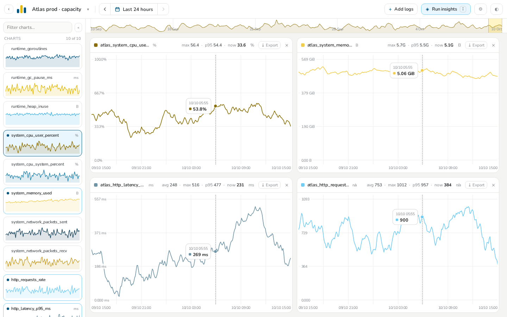
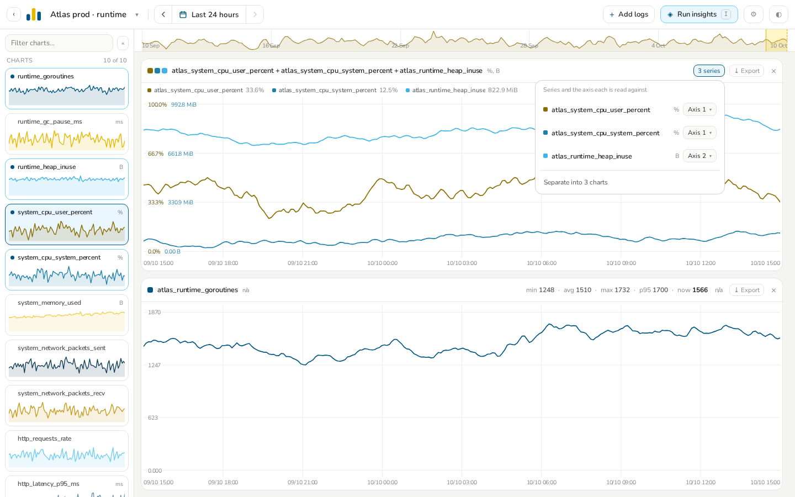
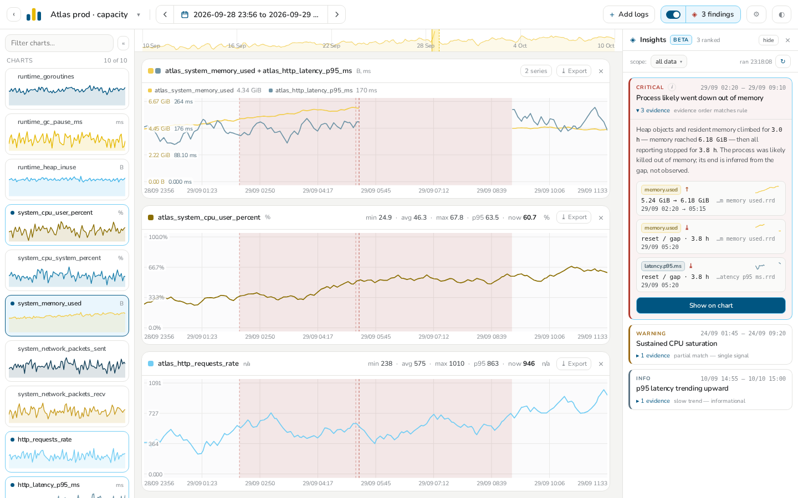
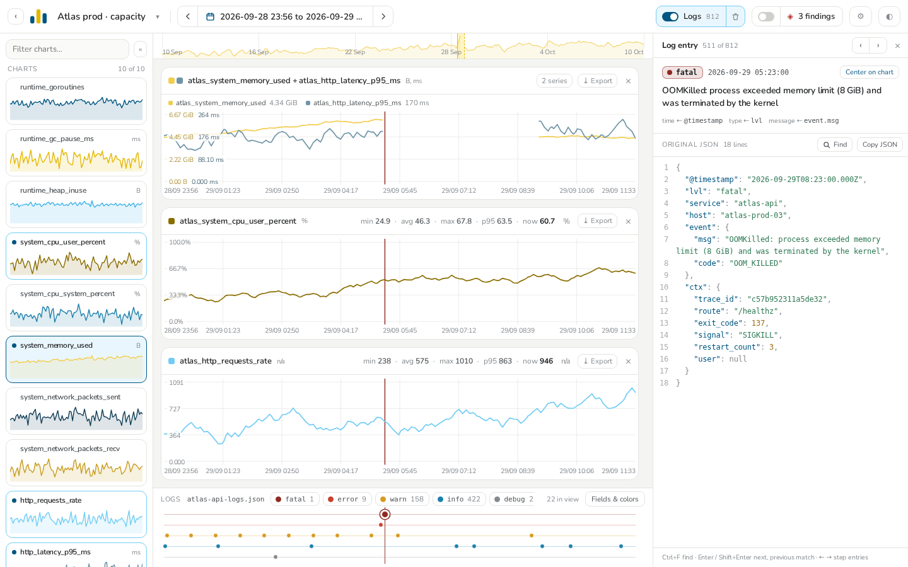

<div align="center">


# RRD Analyzer

**Open a round-robin database and actually read it.**

A desktop application for exploring `.rrd` files and rrdtool XML dumps: stack the metrics you care
about on one time axis, zoom into an afternoon, and let a rule-based pass point at what probably
went wrong.

[**Download for Linux and Windows →**](https://github.com/CharlesLB/rrd-analyzer/releases/latest)

</div>



---

Your files are only ever read; the analyses you create live in `~/.rrd-analyzer/analyses.db`.

## See the charts

Every series is a card in the library. Click it to plot it — as many charts as you like, one column
up to three, two by two from four, three by three from nine. Pick a window or drag across a chart
to zoom; one crosshair reads every chart at once, and each header sums up min, avg, max, p95 and
now. Click a chart's color swatch to repaint its series.

## Merge charts



Drag a chart onto another to merge them. Series of the same unit share a value axis, others get one
of their own, all read on the left. The `n series` button moves a series between axes or splits the
chart again.

## Insights — beta



Run insights (`i`) and a rule-based pass points at what probably went wrong — memory climbing until
reporting stopped, CPU saturation, latency drifting up — ranked by severity, with the evidence one
click away and its interval painted on the charts. The rules are plain TOML files you can override;
see [docs/DEVELOPMENT.md](docs/DEVELOPMENT.md#insights).

## Add logs



**+ Add logs** takes JSON, CSV or plain text logs (`.json`, `.jsonl`, `.ndjson`, `.csv`, `.log`,
`.txt`, up to 25 MB). The time, type and message fields are detected for you, and the entries land
on a track under the charts, one lane per type. Click a marker to open the entry beside the charts.

## Share live

**Share live** turns the open analysis into a public link: whoever opens it sees the same charts,
files and log in a browser, and follows every change you make while the session lives. A warning
says what will be uploaded before anything is. The files, the log and the charts are encrypted on
your machine with a key that travels only inside the link, so the server never sees it.

Everything is erased one hour after the last activity, or as soon as you end the session. The
library marks every analysis *Local* or *Online*, and the share panel marks each of its files. How it
works is in [docs/SHARING.md](docs/SHARING.md).

## Download

Grab the latest build from the [**releases page**](https://github.com/CharlesLB/rrd-analyzer/releases/latest).

| Platform | What to take | Notes |
|---|---|---|
| **Debian, Ubuntu** and derivatives | `rrd-analyzer_<version>_linux_amd64.deb` | `sudo apt install ./rrd-analyzer_*.deb`, then find it in your menu |
| **Arch** and derivatives | `rrd-analyzer_<version>_linux_amd64.pkg.tar.zst` | `sudo pacman -U ./rrd-analyzer_*.pkg.tar.zst`, then find it in your menu |
| **Fedora, other Linux** | `rrd-analyzer_<version>_linux_amd64.tar.gz` | unpack and run; `arm64` is built too |
| **Windows 10, 11** | the installer `.exe` | no elevation needed; a plain `.zip` is there too |

**macOS is not built.** The window is a native webview and nobody has wired up a macOS runner,
so there is no build to download; it can be built from source on a Mac.

Linux needs **GTK 3** and **WebKitGTK 4.1**, which a desktop system almost certainly already
has. Nothing else: binary `.rrd` databases are read directly, and so are XML dumps. `rrdtool`
is only reached for if a database was written in a layout this build cannot read in place — a
32-bit or big-endian machine, or a format version older than `0003`.

Every release ships a `checksums.txt` covering all of it.

## Building it yourself

```bash
pnpm install
make desktop        # needs the GTK and WebKit headers; `make deps` names them
```

Everything else, including the architecture, the insights rules, the release pipeline and how the
RRD parsing works, is in [docs/DEVELOPMENT.md](docs/DEVELOPMENT.md).

## Licence

MIT.
